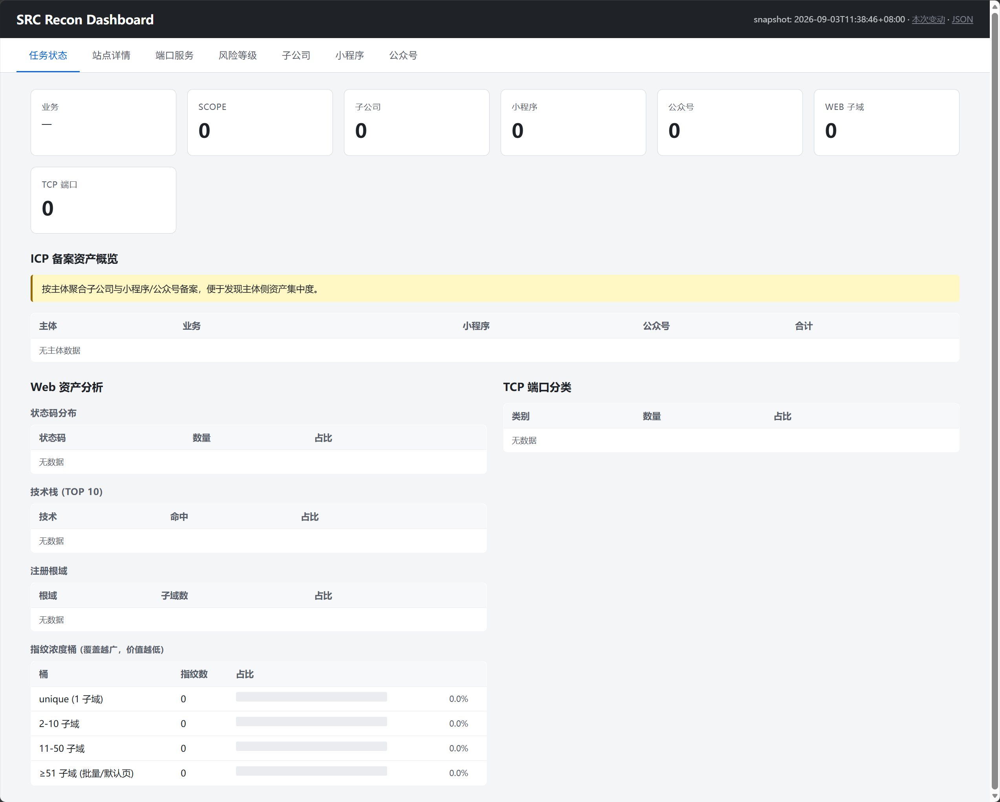

# srcradar — the pipeline of the mapping and of the monitoring of the SRC assets

> English | [中文](README_zh.md)

> the tool chain of SRC that goes from the collection of the assets of a company to the active mapping, to the daily incremental monitoring and to the local visualisation

<p align="left">
  <a href="./LICENSE"></a>
  <a href="./NOTICE"></a>
  
  
  
</p>

<br>

<p align="center">
  
</p>

<p align="center">
  <em>The overview of the dashboard (127.0.0.1:8765, the 4 core tabs: Task Status / Site Details / Port Services / Risk Level)</em>
</p>

<br>

**srcradar** is the pipeline of the mapping and of the monitoring of the SRC assets, all in one place: **a business and the list of its scoped assets → the active mapping → the daily incremental diff → a local dashboard**. Its core parts:

| The role | The module | The nature |
|---|---|---|
| **The backbone** | `pdtm` (the orchestration of the 4 stages of the active mapping) + `daily` (the cron + the diff of the snapshots + the local dashboard) + `manage` (the entry of the businesses) | installed by default, it runs on its own |
| **An optional plugin** | `katana` (the scan of the URL assets) + `health` (the health checks of the operation) + `notify` (the encrypted push of the report) | self deployed, self enabled |
| **A separate repository** | `srcradar-algo-diff-cpp` (the C++ core of the judgement of a change) + `srcradar-mcp-server` (the MCP adapter for the local agents) | installed beside the tree, the sources are not shared |
| **The shared data** | a single SQLite (`db/recon.sqlite3`) connects every output |

The installation / the use / the operation of the optional plugins are in the README of each of them: [`katana/README.md`](./modules/public/katana/README.md) · [`health/README.md`](./modules/public/health/README.md) · [`notify/README.md`](./modules/public/notify/README.md). **It is for the authorized scenarios only** (see the prerequisites and the compliance below). This tool **only collects information**, it does not exploit anything.

> **The plugins of the domestic registries**: `db_align` (the graph of the legal entities, it marks the LOCKED tag) and `ymicp` (the reverse lookup of the filing of the mini programs / of the WeChat accounts) read the Chinese corporate and the ICP registries, so they work only for the targets of China. Their documentation is [`db_align/README.md`](./modules/public/db_align/README.md) · [`ymicp/README.md`](./modules/public/ymicp/README.md). The backbone does not need them: the scopes come from an input directory or from a seed TSV.

---

## The prerequisites and the compliance

This tool is **for the users that hold a legal written authorization** only, and a compliant authorization includes, without being limited to:

- **An agreement of a SRC (a security response center)**
- **An authorization of a penetration test** (the contract / the PDF is kept)
- **A whitelist of the assets** (the assets of the company itself / a托管 agreement that was signed / the domains of a test)

srcradar only provides the **technical implementation**, it **does not take part in, does not endorse and does not know** any concrete use case.

**The operator carries the whole responsibility of the compliance.** It includes, without being limited to: the authorization of the target, the compliance of the cross border transfer of the data (the PIPL / the security assessment of the data that leaves the country), and the respect of the ToS of the data sources such as `爱企查/天眼查/七麦`.

The whole legal terms are in [`LICENSE`](./LICENSE) (Apache-2.0) + [`TERMS_ADDENDUM.md`](./TERMS_ADDENDUM.md) (the additional restrictions of the use and the disclaimer) + [`NOTICE`](./NOTICE) (the thanks to the upstream, and the notices of the optional plugins).

> **The position of the tool**: srcradar is a tool of **information collection** (the enumeration of the subdomains / the resolution of the DNS / the probe of the ports / the probe of the HTTP / the scan of the URL assets), and it **does not exploit anything and does not trigger any PoC**. Use a dedicated vulnerability scanner when a vulnerability has to be verified.

---

## What it is

For the operation of a SRC (a security response center), it turns "a business and the list of its scoped assets → the active mapping of the assets → the daily incremental monitoring" into a single pipeline:

- **The contract of the data**: every output settles in one shared SQLite (`db/recon.sqlite3`), isolated by the name of the business
- **The contract of the operation**: one round runs on its own every day at 03:00 Beijing time, it produces the incremental report + the local dashboard of the visualisation
- **The contract of the collaboration**: it does not take the place of the downstream (the other asset mapping tools), it only connects and orchestrates

---

## The quick start

```bash
# 0. install the system dependencies (Ubuntu/Debian): sqlite3 for the daily DB / cron for the scheduled runs;
#    go/python3/git and the like are guided by ./check.sh
sudo apt update
sudo apt install sqlite3 cron -y

# 1. pull the code (the public mirror)
git clone https://github.com/usdagfhjkda/srcradar.git
cd srcradar

# 2. check the environment (it only checks, it does not install): it needs go>=1.25, python3>=3.12, git>=2.0
./check.sh

# 3. install all the upstream dependencies (pdtm installs dnsx/httpx/subfinder/alterx/naabu/cdncheck
#    -> the init-db on its own;
#    main/{db,lib,manage,pdtm} are ticked by default, daily is not (it avoids the automatic registration of the cron)):
./install.sh                       # the interactive checklist (enter switches / 0 confirms / q quits)
./install.sh --skip-check          # the environment is known to be good, it skips check.sh and goes straight to the checklist

#    The priority of the path of the DB (it is handled at the top of ./srcradar):
#      1) CLI --db / $RECON_DB env
#      2) the recon_db_path of config/db.conf (it is generated at the end of ./install.sh)
#      3) /opt/srcradar/db/recon.sqlite3 (the legacy spot of the older images)
#      4) /data/recon.sqlite3 (it is compatible with the old mount)
#      5) the default of the modules (<repo>/modules/main/db/recon.sqlite3) - this
#         is the one the 1.0.0 image uses: the DB sits next to the db module

# once it is installed, look at what the dispatcher can do (it lists every pair of module/script, it is the cheat sheet of the usual ones)
./srcradar --list

# 6. feed an exact single subdomain + register the business
#    add_business -i <dir> needs a target.txt in the directory;
#    it cleans the target.txt on its own after the success
mkdir -p ~/scope
echo www.example.com > ~/scope/target.txt
./srcradar manage add_business -n test -i ~/scope

# 7. run the pipeline of pdtm of that business (dnsx + scanner.sh + import)
#    the stages are gated by the bits of the table recon_business_config (see the daily operation):
#    the business of the test uses the default values web=1 / tcp=0 / icp=1, it really runs pdtm + icp
./srcradar daily run_one_business test

# 8. start the dashboard (127.0.0.1:8765 by default, only this machine can reach it; see §The startup with Docker for the docker / the remote access)
./srcradar daily dashboard
```

> **The convention of the entry points**: `check.sh` and `install.sh` are the entry points of the refactoring of 2026-09; the old `init.sh` only keeps the two standalone tool entries `--init-db` / `--check-schema` (see [the daily operation](#the-daily-operation)).

> **A new shell has to load the PATH**: `pdtm` and the tools of PD are installed into `~/go/bin/` and `~/.pdtm/go/bin/`, and they **do not** enter the PATH of the current shell on their own; a new shell has to `source ~/.bashrc` or `source ~/.zshrc` by hand (pick the one of your shell), or the script has to `export PATH="$PATH:$HOME/go/bin:$HOME/.pdtm/go/bin"` before `pdtm` / `dnsx` stop reporting that they are not found.

> **Where it is installed**: pdtm is installed into `~/go/bin/`; the tool chain of PD (dnsx/httpx/subfinder/alterx/naabu/cdncheck) is managed by pdtm in `~/.pdtm/go/bin/`; the empty database `db/recon.sqlite3` is created at the end of install.sh. See the comment at the top of [`install.sh`](install.sh).

> **The requirements of the run**: the active scan of srcradar depends on the external tools that install.sh installs (`httpx`, `dnsx`, `naabu`, `subfinder`, `alterx`, `cdncheck`). These tools do not come with the repository, `./check.sh` + `./install.sh` have to run first. See the thanks to the upstream.

### Quick reference (`./srcradar` dispatcher)

There is no need to `cd modules/<x>/<y>` — the `./srcradar` of the root finds and runs the scripts of every module on its own:

```bash
./srcradar --list                    # it lists every pair of (module, script)
./srcradar manage add_business -n exampleCo    # the entry of a business
./srcradar manage set_config  -n exampleCo    # the change of the configuration
./srcradar db init_db                          # it creates an empty SQLite
./srcradar db check_schema                    # it checks the drift of the schema
./srcradar pdtm scan -b exampleCo             # the active scan of a single business
./srcradar daily daily_monitor                 # it runs the daily pipeline by hand
```

The order of the resolution of the modules is `modules/private` → `modules/main` → `modules/public` (an internal module overrides a public one); the type of the script `.sh` comes before `.py`, and a `.sh` file has to carry the executable bit. `./srcradar --list` prints the whole list of the scripts.

---

## The startup with Docker

> A single container runs the whole stack of srcradar: the database is persisted in a named volume, the scopes of the businesses are fed from a bind mount directory, and the dashboard and the MCP daemon are exposed on the loopback only.

```bash
# 1. load the local image (from srcradar-1.0.0_en.tar)
sudo docker load -i ~/srcradar-1.0.0_en.tar

# 2. start the container
#    -v ~/scope:/scope                           the input directory of target.txt / exclude.txt
#    -v srcradar-db:/opt/srcradar/modules/main/db   the persistence of the DB (a named volume, the DB stays when the container is removed)
#    --tmpfs /tmp:rw,mode=1777                  the scratch space of the pipeline (mktemp), wiped with the container
#    -p 127.0.0.1:8765:8765                      the dashboard is only reachable from this machine (it avoids an exposure to the public network)
#    -p 127.0.0.1:8764:8764                      the MCP daemon is only reachable from this machine
sudo docker run -d --name srcradar \
  -v ~/scope:/scope \
  -v srcradar-db:/opt/srcradar/modules/main/db \
  --tmpfs /tmp:rw,mode=1777 \
  -p 127.0.0.1:8765:8765 \
  -p 127.0.0.1:8764:8764 \
  srcradar:1.0.0

# 3. enter the interactive shell of the container
sudo docker exec -it srcradar /bin/bash

# 4. list the scripts (it verifies the dispatcher)
srcradar --list

# 5. feed an exact single subdomain + register the business
echo www.scanme.sh > /scope/target.txt
srcradar manage add_business -n test -i /scope

# 6. run the pipeline of pdtm of that business (dnsx + scanner.sh + import)
srcradar daily run_one_business test

# 7. check the services (the entrypoint of the image already started them)
curl http://127.0.0.1:8765/health    # the dashboard
curl http://127.0.0.1:8764/health    # the MCP daemon
```

> **The surface of the exposed ports**: `-p 127.0.0.1:8765:8765` binds the loopback only, neither the public network nor the other machines of the intranet can reach it; to see the dashboard, `curl http://127.0.0.1:8765/` from the same host is enough, or go through a tunnel of the SSH from a remote host (`ssh -L 8765:127.0.0.1:8765 user@<srcradar-host>`).
>
> **The persistence of the database**: `srcradar-db` is a docker named volume mounted on `/opt/srcradar/modules/main/db`, where the DB lives (next to the db module, because that is where the dashboard and the MCP daemon look for it). On the first start the volume is filled with the content of that directory of the image (the schema and the migration scripts), so `init-db` still finds its schema; the DB itself is in the volume afterwards and survives `docker rm`. To see the content of the database: `sudo docker exec srcradar python3 -c "import sqlite3; c=sqlite3.connect('/opt/srcradar/modules/main/db/recon.sqlite3'); print(c.execute('SELECT * FROM web_subdomains').fetchall())"`.
>
> **The dashboard and the MCP daemon are already running**: the entrypoint of the image starts the dashboard on `0.0.0.0:8765` and the MCP daemon on `0.0.0.0:8764` inside the container, and it registers the crontab of the daily job and the dashboard watchdog. Do not start them a second time: a second dashboard fails with "address already in use". The host side of both mappings is `127.0.0.1`, so only the host reaches them.
>
> **The one time consumption of target.txt**: after the success of `add_business`, `/scope/target.txt` is cleaned up on its own; to feed the scopes again, write `/scope/target.txt` again and run `add_business` again.

---

## The architecture

```
   ┌──────────────────────┐
   │   the business       │        e.g. "ExampleCo"
   └──────────┬───────────┘
              ▼
   ┌──────────────────────────┐
   │ the scopes of a business │
   │  a target.txt, or        │
   │  a seed TSV              │
   └──────────────────────────┘
              ▼
   ┌────────────────────────────────────┐
   │ db/recon.sqlite3  (WAL, shared)    │
   │ businesses · scopes ·              │
   │ web_subdomains · web_hashes ·      │
   │ tcp_assets                         │
   └────────────────────────────────────┘
               ▼
   ┌────────────────────────┐
   │ pdtm (shell + py)      │
   │ the 4 stages of the    │
   │ active mapping:        │
   │ dnsx→naabu→httpx       │
   │ →import_scan_results   │
   └────────────────────────┘
               ▼
   ┌──────────────────────────────────────────────────────────┐
   │ daily/  (cron + Python)                                  │
   │ snapshot.py → diff.py → reports/<run-id>/ + dashboard    │
   └──────────────────────────────────────────────────────────┘
```

<br>

**The key invariants**

- The modules are decoupled **by the name of the business**, the `businesses.id` is the boundary of the isolation
- The scope of a business is the only input of the mapping, the other modules do not widen it
- `daily/` only reads the database and takes a snapshot, it never touches a table of a business

> **The stdin of the tools of ProjectDiscovery has to be closed**: any call of `dnsx` / `httpx` / `naabu` / `subfinder` / `cdncheck` has to get `< /dev/null`, when the script that calls it is run from the outside by `bash script.sh`. Those tools close the stdin in a best-effort way, but it was measured that they park for good in a sub shell, and the pipeline hangs until the end of the time. `cdncheck` still needs it as a fallback, even though the CDN judgement of the pdtm module runs offline and does not call the cdncheck binary any more.

---

## The modules

The tree is made of modules. The ones under `modules/main` are the
backbone, they are installed by default and they run on their own. The
ones under `modules/public` are the optional plugins, they are deployed
and enabled by the operator. The last two live in a repository of their
own.

| The module | The role | The details |
|---|---|---|
| `modules/main/pdtm` | **the active mapping**: the orchestration of the 4 stages (the wildcard resolution → the enumeration and the derivation of the subdomains → the judgement of the CDN + the scan of the ports + the probe of the web → the import into the SQLite) | the tool chain of ProjectDiscovery, it is called, not forked; [README](./modules/main/pdtm/README.md) |
| `modules/main/lib` | **the shared helpers**: the parser of `config/*.conf`, the forwarder of the language lookup, the resolver of the DNS resolver list | every module of the tree reaches it through the same short path |
| `modules/main/daily` | **the daily operation**: the cron, the snapshot of the tables, the diff of the snapshots and the local dashboard | the dashboard binds 127.0.0.1 only, its 4 tabs are Task Status / Site Details / Port Services / Risk Level; [README](./modules/main/daily/README.md) |
| `modules/main/manage` | **the entry of the businesses**: the registration of a business, the switches of a business, the seeds, the language and the resolver set | the scripts of the operator; [README](./modules/main/manage/README.md) |
| `modules/main/db` | **the shared data**: the creation of the SQLite and the incremental migrations of the schema | `db/recon.sqlite3`, the mode WAL + a busy_timeout of 5s |
| `modules/main/i18n` | **the language of the output**: the message tables of the user-visible output and the gate that keeps them consistent | the zh and the en tables, the check of the placeholders and of the bodies; [README](./modules/main/i18n/README.md) |
| `modules/public/katana` | **the plugin of the URL assets**: the scan at the granularity of the URL | optional, self deployed; [README](./modules/public/katana/README.md) |
| `modules/public/health` | **the plugin of the operation**: the health checks of the disk / of the CPU / of the memory / of the cron / of the dashboard | optional, it pushes through the plugin of the notification; [README](./modules/public/health/README.md) |
| `modules/public/notify` | **the plugin of the push**: the encrypted report of the day, sent to the mailbox of the operator | optional, the body is encrypted with GPG; [README](./modules/public/notify/README.md) |
| `srcradar-algo-diff-cpp` | **the judgement of a change**: the C++ core that decides, for every asset, whether it changed since the day before | a repository of its own, the tree calls its binary, the sources are not shared |
| `srcradar-mcp-server` | **the adapter for the agents**: it exposes the commands of the tree over the MCP protocol, so a local agent calls them over HTTP instead of opening a session on the host | a repository of its own, it holds no data of the businesses, it only forwards the calls |

---

## The model of the shared data

The database `db/recon.sqlite3`, the mode WAL + a busy_timeout of 5s.

| The table | What it holds | Who writes it |
|---|---|---|
| `businesses` | the dictionary of the SRC businesses (`id`, `business_name`) | anybody, it is unique by `business_name` |
| `recon_business_config` | the switches of the stages of a business (`business_id`, `enabled`, `web`, `tcp`, `icp`) | a manual SQL; `daily_monitor.sh` reads it and filters by business |
| `scopes` | the whitelist of the measurable and of the assets that are not measurable | **`pdtm finalize_scope`** / **`manage/scope_import.sh`** (2 independent paths, any of them is enough) |
| `web_subdomains` / `web_hashes` | the web assets + the library of the fingerprints | `pdtm/import_scan_results.py` |
| `tcp_assets` | the assets of the TCP ports | `pdtm/import_scan_results.py` |
| `permutation_state` | the cache of the state of the derivation of alterx (a cooling of 30 days per entry for the moment; **it has to become a wipe of the whole table per period**) | `pdtm/permutation_cache.py` |

The contract of the collaboration of the fields is in the README of each module — `pdtm/README.md` §DB Schema.

---

## The daily operation

> This section answers the question "what do I do once it is installed". The runbook of the entry point of the scripts is in the README of each module, here are only the most used ones.

The detailed documentation sits next to the scripts:

- **add a business / change the switch of a business / the seed TSV** → [`manage/README.md`](./modules/main/manage/README.md)
- **install the cron / remove the cron / run a single business by hand / take a snapshot / the dashboard** → [`daily/README.md`](./modules/main/daily/README.md)
- **enter the scopes / run the whole pipeline** → [`pdtm/README.md`](./modules/main/pdtm/README.md)

### The language of the output

The user-visible output (the `--help` of the tools, the runtime messages,
the pages of the dashboard, the daily report and the body of the mail)
follows one setting. The resolution order is:

1. the `SRCDAR_LANG` environment variable (for the CI and the temporary
   overrides)
2. the `lang` field of `config/lang.conf` (the persistent choice of the
   operator)
3. `en` as the default

The installer of the i18n module writes `config/lang.conf` on the first
install, and it never overwrites an existing one: the choice of the
operator wins there. The deliberate switch is the script of the manage
module:

```bash
./srcradar manage set_lang            # shows the language in effect
./srcradar manage set_lang --lang zh  # Chinese
./srcradar manage set_lang --lang en  # English
```

The dashboard also takes the language per request: `?lang=zh` or
`?lang=en` overrides the setting for that one page.

### The DNS resolver set

The lists live in `modules/main/pdtm/resolvers/`, one file per set:
`cn` (the resolvers of the domestic operators) and `global` (the public
resolvers of the world). The domestic resolvers answer the foreign names
differently from the public ones, and the difference shows in the assets
that are collected.

```bash
./srcradar manage set_resolvers                # shows the set in effect
./srcradar manage set_resolvers --set cn       # the domestic set
./srcradar manage set_resolvers --set global   # the public resolvers of the world
./srcradar manage set_resolvers --set auto     # the language decides
```

The `auto` mode follows the language: the Chinese language means the
domestic set, every other language means the global set. The language is
the field that `set_lang.sh` writes, so the two settings stay in step.

The choice is the `resolver_set` field of `config/pdtm.conf`. The
installer writes the default only when the field is missing, so an
install does not reset the choice of the operator.

### The commands of the common tasks

> Every command runs from the root of the repository; `./srcradar --list` prints the whole list of the scripts.
> The stages (`pdtm` / `daily-url`) are configured with a 0/1 per business in the table `recon_business_config`
> (web/tcp drive pdtm). See the top of [`daily/run_one_business.sh`](./modules/main/daily/run_one_business.sh).

| The task | The command |
|---|---|
| create a business + fill the scopes | `./srcradar manage add_business -n <business name> -i <input_dir>` |
| only store the scopes without scanning (to fill the old scopes back) | `./srcradar pdtm scope_import -b <business> -i <input_dir>` |
| look at / change the switch of a business | `./srcradar manage set_config -n <business name> [--enable/--disable/--web 0\|1 --tcp 0\|1 --icp 0\|1]` |
| look at / change the language of the output | `./srcradar manage set_lang [--lang zh\|en]` |
| look at / change the DNS resolver set | `./srcradar manage set_resolvers [--set cn\|global\|auto]` |
| run the whole flow of a single business (once the scopes are in, it is gated by the table of the configuration) | `./srcradar daily run_one_business <business name>` |
| install the cron (every day at 03:00 Beijing time) | `./srcradar daily install_cron` |
| remove the cron | `./srcradar daily install_cron uninstall` |
| see whether the cron is installed | `crontab -l \| grep daily_monitor` |
| start the dashboard (127.0.0.1:8765 by default) | `./srcradar daily dashboard` |

### The order of the stages (it is fixed inside the pipeline / inside run_one_business)

```
pdtm  →  daily-url
  ↓              ↓
writes web_sub /  writes web_hash_urls
tcp_assets
```

A failure of a stage does not block the stages that come after — `run_one_business.sh` returns an **exit code of a bit mask**:

| The bit | What it means |
|---|---|
| 1 (1) | pdtm failed |
| 2 (2) | the stage of the legal entities failed (it belongs to an optional plugin) |
| 4 (4) | the stage of the filings failed (it belongs to an optional plugin) |
| 8 (8) | daily-url failed |
| 0 | everything is OK or it was skipped |

### A business can skip the cron (the operator controls it in the background)

Every business has the switch `recon_business_config.enabled`. After a `--disable`, **every stage** of that business is skipped by the cron and by `run_one_business.sh`, but **the snapshot is still taken** (it watches the additions of the period when it did not run).

```bash
./srcradar manage set_config -n <business name> --disable   # pause it
./srcradar manage set_config -n <business name> --enable    # restore it
./srcradar manage set_config -n <business name>             # show the current configuration
```

The detailed semantics are in `daily/README.md`, in the sections "Skipping a business that should not run" and "Installing / removing the cron".

---

## The thanks to the upstream

The executable capacity of this project rests on the following upstream projects, see the `LICENSE` (Apache-2.0) at the top and the file [`NOTICE`](./NOTICE).

### The upstream of the code (srcradar calls it directly or depends on its source)

| The upstream project | The role | The license | The maintenance relation |
|---|---|---|---|
| **[projectdiscovery/httpx](https://github.com/projectdiscovery/httpx)** | the active probe of the web | **MIT** | © 2021-2025 ProjectDiscovery, Inc. |
| **[projectdiscovery/dnsx](https://github.com/projectdiscovery/dnsx)** | the batch resolution of the DNS | **MIT** | © 2021-2025 ProjectDiscovery, Inc. |
| **projectdiscovery/cdncheck** (it is imported by the CDN judgement of the pdtm module, the source is not modified) | the offline classification of the CDN / of the WAF | **MIT** | © 2021-2025 ProjectDiscovery, Inc. |

### The management of the packages and the external dependencies (the set of the tools that pdtm installs + the tools that are recommended)

| The tool | The upstream | The license | The maintenance relation |
|---|---|---|---|
| **[pdtm](https://github.com/projectdiscovery/pdtm)** | the package manager (it installs the tool chain of PD) | **MIT** | © 2021-2025 ProjectDiscovery, Inc. |
| **[subfinder](https://github.com/projectdiscovery/subfinder)** | the enumeration of the subdomains | **MIT** | © 2021-2025 ProjectDiscovery, Inc. |
| **[alterx](https://github.com/projectdiscovery/alterx)** | the derivation of the keywords | **MIT** | © 2021-2025 ProjectDiscovery, Inc. |
| **[naabu](https://github.com/projectdiscovery/naabu)** | the scan of the TCP ports | **MIT** | © 2021-2025 ProjectDiscovery, Inc. |
| **[ffuf](https://github.com/ffuf/ffuf)** | the brute force of the URLs with a dictionary (`pdtm/scan_urls.py`) | **MIT** | © 2021 Joona Hoikkala |
| **[gau](https://github.com/lc/gau)** | the wayback / the historical URLs (`pdtm/scan_urls.py`) | **MIT** | © 2025 Corben Leo |
| **[URLFinder](https://github.com/pingc0y/URLFinder)** (the Chinese community edition by pingc0y) | the active crawler (`pdtm/scan_urls.py`) | **MIT** | © 2022 pingc0y |
| **[massdns](https://github.com/blechschmidt/massdns)** | the batch resolution of the DNS at a high performance (the stage of the brute force, a hard dependency of shuffledns) | ⚠️ **GPL-3.0** | © 2017 Marc Blechschmidt |
| **[shuffledns](https://github.com/projectdiscovery/shuffledns)** | the resolution of the DNS (the stage of the brute force) | ⚠️ **GPL-3.0** | © 2022 ProjectDiscovery, Inc. |

> **The mode of the integration**: every tool of this section is called through a `subprocess.run()` by a script such as `pdtm/scan_urls.py`, it is **not a fork of the source / an import**.
> `massdns` and `shuffledns` are the only two tools of **GPL-3.0** here: they run as separate processes and they are not linked with the code of this repository; the whole text of their licenses comes with the mirror in `/usr/share/doc/srcradar/licenses/`, and the whole statement is in [`NOTICE`](./NOTICE). `pdtm` is the package manager, it is **not** the upstream of the code of these tools.
>
> **The versions of the upstream**: the tools of ProjectDiscovery are installed into `~/.pdtm/go/bin/` by `pdtm -duc -i dnsx,httpx,subfinder,alterx,naabu,cdncheck`, there is no lock (the user manages the upgrades). The versions of the optional plugins are in [`NOTICE`](./NOTICE).

### The data that comes with the repository (the word lists)

| The data | The upstream | The license | The maintenance relation |
|---|---|---|---|
| **[danielmiessler/SecLists](https://github.com/danielmiessler/SecLists)** `Discovery/DNS/` (the original of `subdomains-top1million-20000.txt` + the cleaned product of `dns-Jhaddix.txt`) | the word list of the brute force of the DNS subdomains (the brute stage of `pdtm/scan.sh`) | **MIT** | © 2018 Daniel Miessler |

The word lists under `docker/wordlists/` **come with the repository**, they are different from the tools of the table above that "pdtm installs at the time of the run". The `dns-Jhaddix-clean.txt` is a cleaned derivative of the file of the upstream (the filtering + the deduplication + the sorting, the exact rules are in [`NOTICE`](./NOTICE)), and it is redistributed under the terms of the MIT. The whole statement is in [`NOTICE`](./NOTICE).

### The statement of the third party services (the user deploys them)

The optional plugins call the third party services that they declare in their own README. srcradar **does not** redistribute those servers, **does not** pull the images on its own and **does not** endorse their compliance. The whole statement is in [`NOTICE`](./NOTICE) and in [`TERMS_ADDENDUM.md`](./TERMS_ADDENDUM.md).

---

## License

srcradar is distributed under the Apache License 2.0, the whole terms are in [`LICENSE`](./LICENSE).
The upstream projects and their own licenses are in `## The thanks to the upstream` and in [`NOTICE`](./NOTICE).
The prerequisites of the use of the tools and the disclaimer are in [`TERMS_ADDENDUM.md`](./TERMS_ADDENDUM.md).


